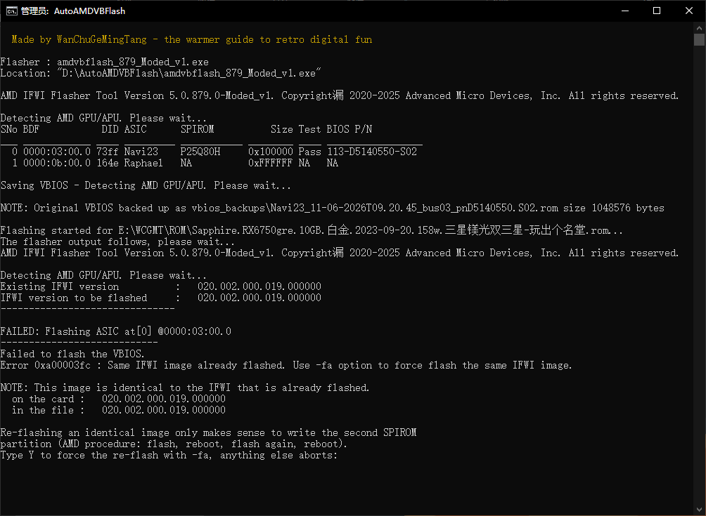
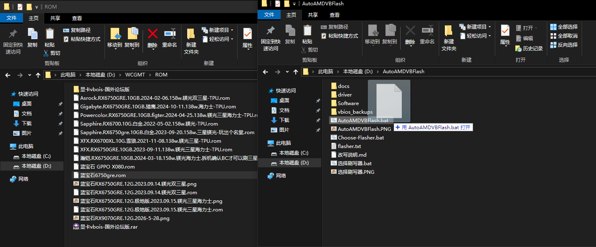
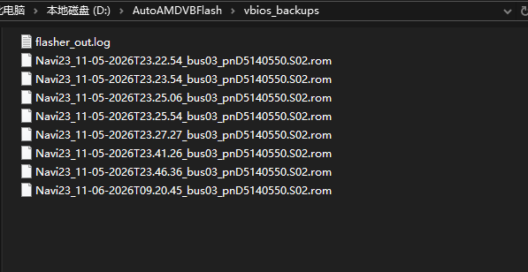
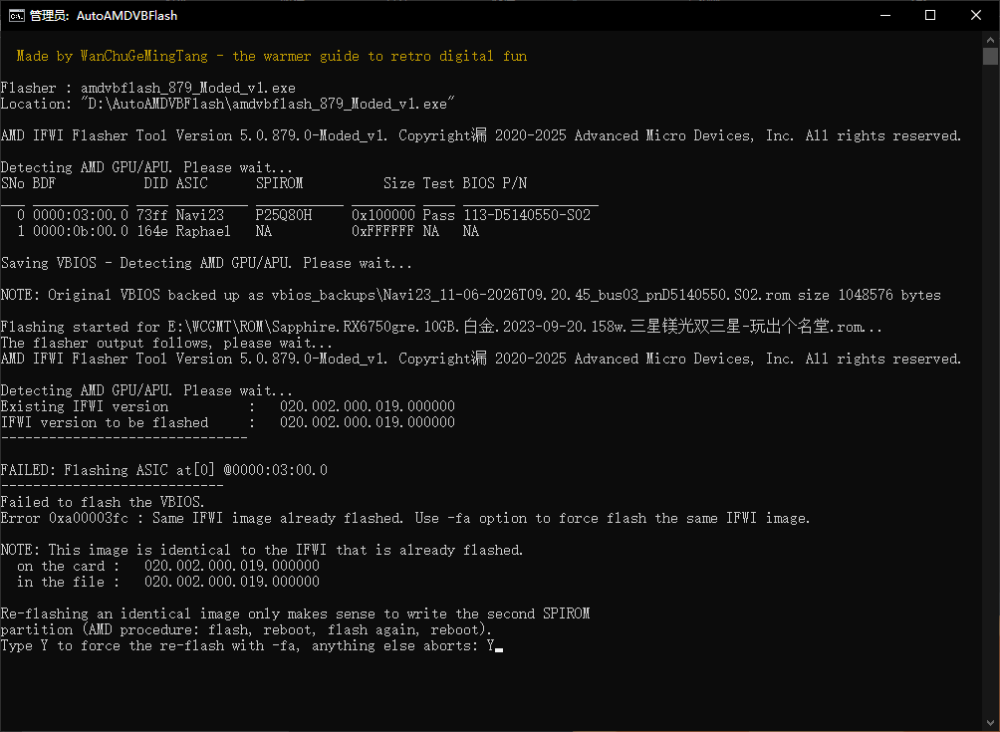
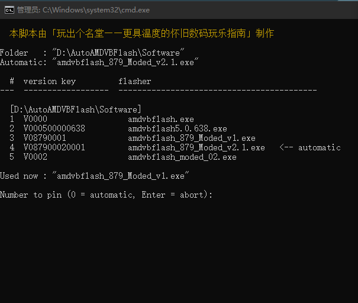

# AutoAMDVBFlash

[中文](README.md) | **English**

> Made by WanChuGeMingTang - the warmer guide to retro digital fun

A Windows batch tool for AMD Navi GPUs: double-click to back up the VBIOS, drop a `.rom` onto the script to force-flash it, and keep whatever `amdvbflash` build you have in the folder.



*A full run of `AutoAMDVBFlash-EN.bat`: it lists every `amdvbflash` build in the folder, picks one automatically,
saves the VBIOS into `vbios_backups\`, then reports the flasher's own refusal message and asks what to do*

## What it solves

The original portable package hard-coded one flasher build and broke as soon as the folder was renamed. This script removes those limits:

- **No hard-coded flasher** - any `amdvbflash*.exe` in the folder works; the highest version in the file name wins
- **The folder can be renamed or moved anywhere** - spaces, parentheses and non-ASCII paths are tested; the UAC relaunch no longer depends on a `.lnk`
- **Drop the `.rom` from anywhere** - Chinese names, spaces and `&` all work
- **Cross-model and downgrade flashing** - when the flasher refuses the image over the PartNumber or the IFWI version, the script prints its exact message, asks for `Y`, then retries with `-fv -fp`. A cross-brand (SSID) mismatch is no longer bypassed: the confirmed retry is still refused
- **Re-flash the same image** - on `Same IFWI image already flashed` it asks for `Y` and re-flashes with `-fa`, which is how the second SPIROM partition gets written
- **Two builds** - `AutoAMDVBFlash.bat` (Chinese, GBK) and `AutoAMDVBFlash-EN.bat` (English, pure ASCII, runs on any code page)

## Folder layout

```
AutoAMDVBFlash\
├─ AutoAMDVBFlash.bat        main script (Chinese)
├─ AutoAMDVBFlash-EN.bat     main script (English, pure ASCII)
├─ 选择刷写器.bat             version picker (Chinese prompts)
├─ Choose-Flasher.bat        version picker (English prompts)
├─ Software\                 put amdvbflash*.exe here        <- bring your own
├─ driver\                   AmdTools driver + loader scripts <- bring your own
└─ vbios_backups\            output (created on first run)
```

> **This repository contains scripts only.** `amdvbflash*.exe` is AMD's closed-source tool and the
> `driver\` folder holds AMD's signed driver, so neither is redistributed here. Take them from the AMD
> package, from a portable package you already have, or from your own backup, and put them into
> `Software\` and `driver\`.

## Ready-to-run package (optional)

For a package that already contains `amdvbflash` and the AmdTools driver, use the author's card page:

**<https://cardlink.cc/wanchugemingtang>**

If you only want the scripts, download the scripts-only archive from
[Releases](https://github.com/WanChuGeMingTang/AutoAMDVBFlash/releases) and drop your own
`amdvbflash*.exe` into `Software\` and the driver into `driver\`.

> The `amdvbflash*.exe` builds, the AmdTools driver and AMD's documents inside that package remain AMD's
> property (some flasher builds are third-party modifications, owned by their authors) and are **not
> covered by this project's MIT license**. Use them at your own risk.

## Quick start

1. Put your `amdvbflash*.exe` into `Software\` (any 5.x build, several are fine)
2. Put the `driver\` files in place (`amdtools.inf`, `AmdTools64.sys`, `Amdtools.cat`, `devcon64.exe`, `admin_*.bat`)
3. Double-click `AutoAMDVBFlash.bat` - the VBIOS is backed up into `vbios_backups\`
4. To flash: drop a `.rom` onto the `AutoAMDVBFlash.bat` icon



*Backup = double-click. Flash = drag a `.rom` from any folder onto the script icon and release on "Open".*

## Usage

### Backup

Double-click the script, or run it from an already elevated console. Backup files are named like
`Navi23_<time>_bus03_pn<BIOS P/N>.S02.rom`, and `flasher_out.log` keeps the raw output of the flasher.



*Every run leaves a 1 MB VBIOS image plus `flasher_out.log` in `vbios_backups\`*

### Force flash

Drop the `.rom` onto the script: it backs up first, then flashes. When the flasher refuses the image,
the script repeats the flasher's own wording, explains the risk and waits for a confirmation:



*Typing `Y` starts the forced flash; anything else aborts and the card is left untouched*

### Choosing a flasher version

Run `Choose-Flasher.bat` (English) or `选择刷写器.bat` (Chinese). Both list every `amdvbflash*.exe` found in the
three folders; type the index to pin it into `flasher.txt`, or `0` to go back to automatic (highest version).



### Search order

① script folder → ② `.\Software` → ③ `..\Software`. The first folder that contains a flasher wins.

## FAQ

| Symptom | Meaning / action |
|---|---|
| `0xA00003FF PartNumber mismatch` | cross-model image; the script asks for `Y` and retries with `-fp` |
| `0xA00003FE SSID mismatch` | cross-brand image; `-fs` is not passed, so the confirmed retry is still refused - use an image for this brand |
| `0xA00003FC Same IFWI image already flashed` | the image equals the one on the card; `Y` re-flashes with `-fa` (second partition) |
| `The AMD Special Tools Driver ... not installed` | `driver\` is missing or failed to load; the script loads it automatically, check the window |
| `Please REBOOT ...` after flashing | normal. **Reboot and flash once more** - both SPIROM partitions need one pass each |

**Do I need Safe Mode?** No. The tool has supported flashing with the AMD driver installed since 5.0.572.
What actually matters: reboot before flashing, close GPU monitoring/overclocking tools, and flash twice
(rebooting in between).

## Disclaimer

Flashing a GPU BIOS can **brick the card**, especially when mixing brands or models. The author takes no
responsibility for any damage. Make sure you have an iGPU or a second GPU for recovery, and keep a copy of
the original VBIOS. Every forced flash in this script requires an explicit `Y`.

## License

MIT, see [LICENSE](LICENSE).
