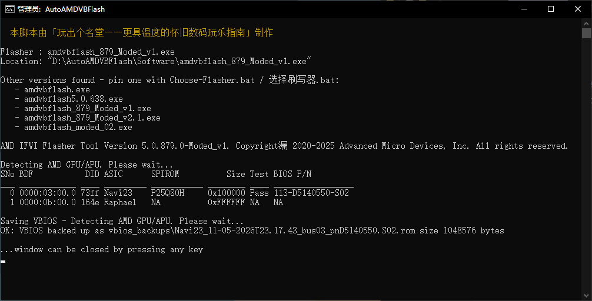
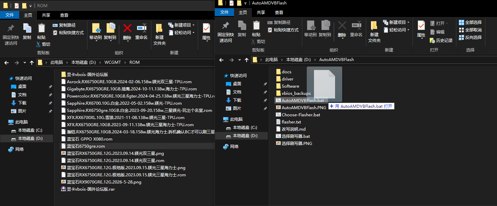
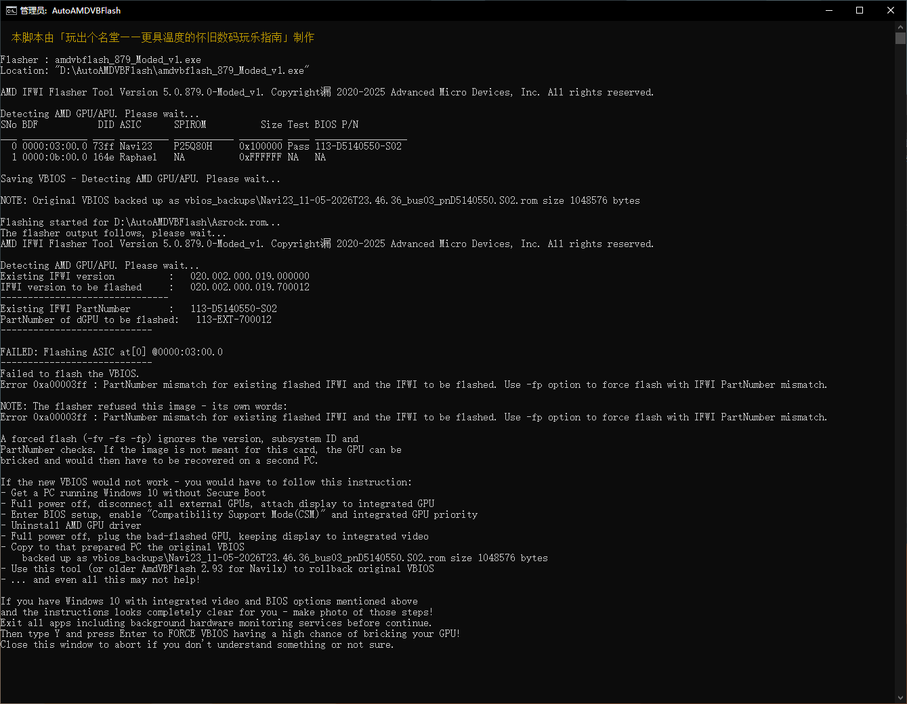
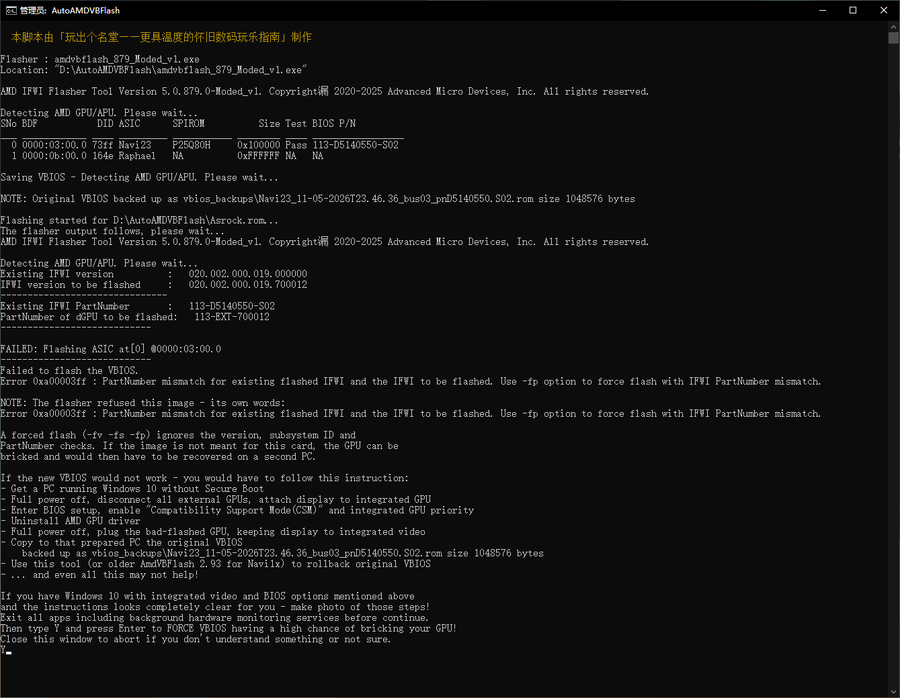
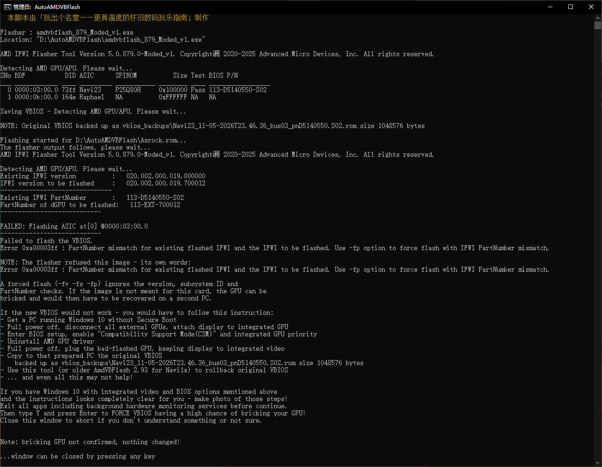
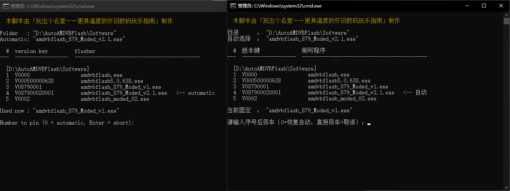

# AutoAMDVBFlash

**中文** | [English](README.en.md)

> 本脚本由「玩出个名堂——更具温度的怀旧数码玩乐指南」制作

一个跑在 Windows 下的 AMD 显卡 VBIOS 备份 / 强刷工具：双击备份，拖拽 `.rom` 强刷，自动识别你放在目录里的任意版本 `amdvbflash`。



*主界面：列出目录里所有 `amdvbflash` 版本、自动选中一个，完成备份并保存到 `vbios_backups\`*

## 它解决什么问题

原版便携刷写包把刷写程序写死成某个固定版本、目录一改名就失效。这个脚本把这些限制去掉了：

- **不再绑死刷写程序**：目录里任何 `amdvbflash*.exe` 都能用，按文件名版本号自动挑最大的
- **目录可以随便改名/移动**：含空格、括号、中文路径都测过；提权不再依赖 `.lnk`
- **拖拽路径不受限**：`.rom` 从任意文件夹拖进来都行，中文名、空格、`&` 都没问题
- **跨品牌/跨型号可强刷**：刷写程序拒绝时（SSID / PartNumber 不匹配），脚本会列出它的原话，要求输入 `Y` 后用 `-fv -fs -fp` 强制刷写
- **同镜像可重刷**：`Same IFWI image already flashed` 时询问是否用 `-fa` 重刷，用来写第二个 SPIROM 分区
- **中英双版本**：`AutoAMDVBFlash.bat`（中文，GBK）与 `AutoAMDVBFlash-EN.bat`（英文，纯 ASCII，任意代码页可用）

## 目录结构

```
AutoAMDVBFlash\
├─ AutoAMDVBFlash.bat        主脚本（中文）
├─ AutoAMDVBFlash-EN.bat     主脚本（英文，纯 ASCII）
├─ 选择刷写器.bat             选版本（中文提示）
├─ Choose-Flasher.bat        选版本（英文提示）
├─ Software\                 放 amdvbflash*.exe        ← 需自备
├─ driver\                   AmdTools 驱动及加载脚本    ← 需自备
└─ vbios_backups\            备份产物（运行后生成）
```

> **本仓库只包含脚本**。`amdvbflash*.exe` 是 AMD 的闭源工具，`driver\` 里是 AMD 签名的驱动，
> 均不便随仓库分发，请自备：从 AMD 官方包、作者便携包或你自己的旧目录里取，
> 放到 `Software\` 与 `driver\` 即可。

## 快速开始

1. 把 `amdvbflash*.exe` 放进 `Software\`（任意 5.x 版本，多个也行）
2. 把 `driver\`（`amdtools.inf`、`AmdTools64.sys`、`Amdtools.cat`、`devcon64.exe`、`admin_*.bat`）放好
3. 双击 `AutoAMDVBFlash.bat` → 备份 VBIOS 到 `vbios_backups\`
4. 想刷固件：把 `.rom` 拖到 `AutoAMDVBFlash.bat` 图标上



*备份就双击脚本；刷写就把 `.rom` 从任意文件夹拖到脚本图标上（出现「打开」提示时松手）*

## 使用说明

### 备份

双击脚本，或在已有管理员权限的窗口里运行。备份文件名形如
`Navi23_<时间>_bus03_pn<BIOS P/N>.S02.rom`，同时保留 `flasher_out.log`（刷写程序原始输出）。

### 强刷

把 `.rom` 拖到脚本上，脚本会先备份、再刷写。遇到校验拒绝时：





输入 `Y` 才会强制刷写；输入其它内容直接放弃，显卡不动。



### 选版本

双击 `选择刷写器.bat`（中文）或 `Choose-Flasher.bat`（英文），会列出三个目录里所有 `amdvbflash*.exe`，
输入序号即写入 `flasher.txt` 固定下来；输入 `0` 恢复自动（版本号最大者胜出）。



### 搜索顺序

①脚本目录 → ②`.\Software` → ③`..\Software`，第一个有刷写程序的目录生效。

## 常见问题

| 现象 | 含义 / 处理 |
|---|---|
| `0xA00003FF PartNumber mismatch` | 跨型号混刷，脚本会要求 `Y` 后用 `-fp` 强刷 |
| `0xA00003FE SSID mismatch` | 跨品牌混刷，脚本用 `-fs` |
| `0xA00003FC Same IFWI image already flashed` | 镜像与卡上一致；`Y` 则用 `-fa` 重刷（写第二分区） |
| `The AMD Special Tools Driver ... not installed` | `driver\` 缺失或加载失败，脚本会自动加载，失败时看窗口提示 |
| 刷完提示 `Please REBOOT` | 正常。**重启后再刷一遍**，两个 SPIROM 分区各刷一次才算完成 |

**要不要进安全模式**：不必。官方从 5.0.572 起就支持在装了 AMD 驱动的情况下刷写。
比安全模式更重要的是：刷前重启、关掉显卡监控/超频软件、刷两遍（中间重启一次）。

## 免责声明

刷写显卡 BIOS 有**变砖风险**，尤其是跨品牌/跨型号混刷。作者不对任何损坏负责。
动手前请确认你有核显或第二块显卡可以救砖，并保留原厂 VBIOS 备份。
脚本里所有强制刷写都需要手动输入 `Y` 确认，默认不强制。

## 许可

MIT，见 [LICENSE](LICENSE)。

---

English documentation: **[README.en.md](README.en.md)**

